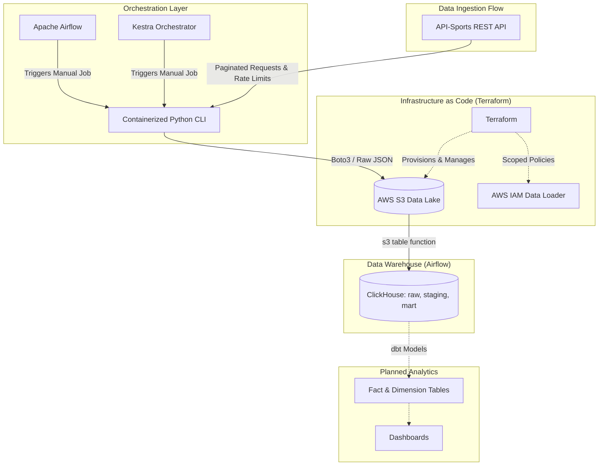
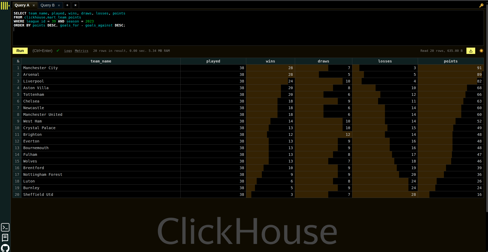
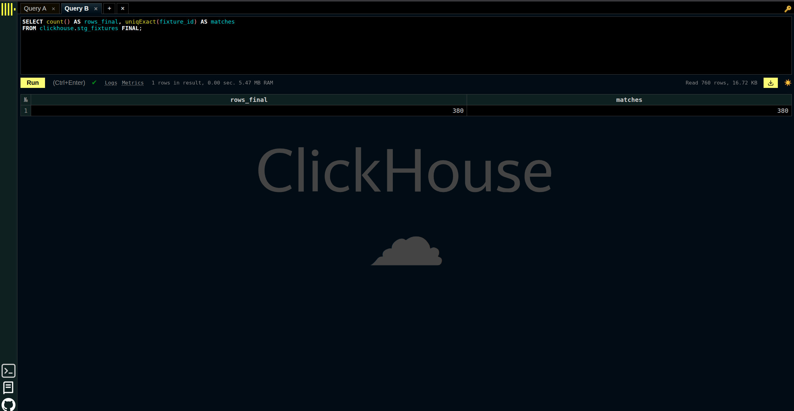

# ⚽ Football Data Pipeline (ELT)

[](https://www.python.org/)
[](https://docs.astral.sh/uv/)
[](https://www.terraform.io/)
[](https://aws.amazon.com/s3/)
[]()
[](#)

An end-to-end Data Engineering ELT pipeline designed to extract football sports statistics from API-Sports, store raw JSON payloads into an AWS S3 Data Lake, and automate batch execution workflows with Apache Airflow or Kestra.

>💡 Project Background:
>This project is inspired by the DataTalks.Club Data Engineering Zoomcamp, but completely re-engineered around a live external sports domain instead of the default NYC Taxi dataset.
>It features a custom CLI-based ingestion tool with pagination and API rate-limiting, optimized container packaging using Astral uv for fast dependency management executed under an unprivileged user, and fully automated cloud infrastructure provisioned via Terraform with remote S3 state storage and DynamoDB locking.

## 🏗 System Architecture



---

## ⚙️ Key Technical Features

* **Infrastructure as Code (IaC):** AWS S3 landing bucket and scoped IAM ingestion policies managed via **Terraform** (~> 6.0) with remote S3 backend state and DynamoDB state locking.
* **Resilient Ingestion Engine (`src/`):** Parameterized CLI built with `click` and `requests`. Features automated pagination, rate-limit sleep windows, dynamic S3 folder partitioning from per-endpoint templates (e.g. `league_id / season / date`), and structured logging.
* **Orchestration Layer:** **Apache Airflow 3.3.2** and **Kestra 2.0** available as alternative Docker Compose stacks, each backed by its own PostgreSQL 18 metadata database for task execution.
* **Local Data Warehouse:** **ClickHouse 26.8 LTS** included in each orchestration stack, with persistent volumes and a health check. The Airflow DAG `football_fixtures_elt` loads match results from S3 into raw and staging tables and builds a team points mart.
* **Secure & Fast Containerization:** Lightweight Docker images leveraging Astral `uv` for sub-second dependency resolution, running under an unprivileged user (`ingest_user`) for container security.

---

## 📂 Repository Structure

```text
football-data-pipeline/
├── configs/                  # Pipeline configs and API endpoint definitions
├── orchestration/            
│   ├── airflow/              # Apache Airflow compose.yaml and DAGs
│   └── kestra/               # Kestra compose.yaml and Flows
├── src/                      # Clean Architecture source code
│   └── football_pipeline/
│       ├── cli.py            # CLI entrypoint
│       ├── core/             # Configuration and logging
│       ├── domain/           # Domain schemas and entities
│       ├── extractors/       # API-Sports extraction clients
│       ├── services/         # Ingestion orchestration services
│       ├── storage/          # S3 storage clients and uploaders
│       └── warehouse/        # ClickHouse loading CLI and SQL models
├── terraform/                # IaC definitions (S3, IAM)
├── terraform-backend/        # IaC state bucket and lock table definitions
├── tests/                    # Unit test suite
├── Dockerfile                # Hardened container build recipe (Python 3.13 + uv)
├── pyproject.toml            # Project packaging metadata and build definitions
└── uv.lock                   # Locked dependency tree
```

## 🛠 Tech Stack

| Domain | Tools / Technologies |
| :--- | :--- |
| **Language** | Python 3.13 |
| **Dependency Management** | Astral `uv`, `hatchling` |
| **CLI Framework** | `click` |
| **Cloud Storage** | AWS S3 |
| **Infrastructure as Code** | Terraform (AWS Provider ~> 6.0) |
| **Orchestration** | Apache Airflow 3.3.2, Kestra 2.0, PostgreSQL 18 |
| **Data Warehouse** | ClickHouse 26.8 LTS |
| **Containerization** | Docker, Docker Compose |

---

## 🚀 Setup & Quickstart

### 1. Provision Infrastructure with Terraform
Navigate to the terraform directory to initialize and deploy the S3 Data Lake and IAM credentials:
```bash
# 1. Initialize remote state and lock table
cd terraform-backend
terraform init
terraform apply -auto-approve

# 2. Provision landing zone and IAM
cd ../terraform
terraform init
terraform plan -var="environment=dev"
terraform apply -var="environment=dev"
```

### 2. Configure Environment Variables
Create a .env file in the project root based on your credentials:

```.env
# Ingestion API Configuration
FLOW_API_FOOTBALL_KEY=your_football_api_key

# AWS Configuration & Credentials
FLOW_AWS_ACCESS_KEY_ID=your_aws_access_key_id
FLOW_AWS_SECRET_ACCESS_KEY=your_aws_secret_access_key
AWS_DEFAULT_REGION=eu-central-1
AWS_S3_LANDING_BUCKET_NAME=football-data-pipeline-landing-zone-dev

# Airflow Credentials & Security
AIRFLOW_POSTGRES_USER=airflow
AIRFLOW_POSTGRES_PASSWORD=airflow
AIRFLOW_POSTGRES_DB=airflow
_AIRFLOW_WWW_USER_USERNAME=admin
_AIRFLOW_WWW_USER_PASSWORD=admin
AIRFLOW_UID=50000
AIRFLOW_DOCKER_GID=999
FERNET_KEY=your_fernet_key_here
AIRFLOW__API_AUTH__JWT_SECRET=your_generated_jwt_secret_here
AIRFLOW__API_AUTH__JWT_ISSUER=football-data-pipeline

# Kestra Credentials
KESTRA_POSTGRES_USER=kestra
KESTRA_POSTGRES_PASSWORD=kestra_password
KESTRA_POSTGRES_DB=kestra
KESTRA_USER=admin@example.com
KESTRA_PASSWORD=admin_password

# ClickHouse Credentials
CLICKHOUSE_USER=clickhouse
CLICKHOUSE_PASSWORD=your_clickhouse_db_password
CLICKHOUSE_DB=clickhouse
```

### 3. Build the Ingestion Image
The manual Docker run, Airflow DAG, and Kestra flow all use this image:
```bash
docker build -t football-pipeline:latest .
```

### 4. Launch Orchestrator
Launch Airflow:
```bash
docker compose --env-file .env -f orchestration/airflow/compose.yaml up -d
```

Or Kestra:
```bash
docker compose --env-file .env -f orchestration/kestra/compose.yaml up -d
```

Run one stack at a time: both publish ports `8080`, `8123`, and `9000`. Each stack has its own ClickHouse instance and volumes, so data is not shared between them.

| Service | Address |
| :--- | :--- |
| Airflow or Kestra Web UI | `http://localhost:8080` |
| ClickHouse health check | `http://localhost:8123/ping` |
| ClickHouse SQL UI | `http://localhost:8123/play` |
| ClickHouse native TCP | `localhost:9000` |

### 5. Run Manual Ingestion
You can test the ingestion engine directly using uv:
```bash
uv run football-pipeline --endpoint leagues --league-id 39
uv run football-pipeline --endpoint teams --league-id 39 --season 2024
```

Or run it inside the Docker container:
```bash
docker run --rm --env-file .env football-pipeline:latest football-pipeline --endpoint leagues --league-id 39
```

### 6. Run the Fixtures ELT DAG
Unpause and trigger `football_fixtures_elt` in the Airflow UI (parameters: `league_id`, `season`). It runs three tasks:

1. `extract_fixtures`: API-Football to S3.
2. `load_fixtures_to_clickhouse`: S3 to `raw_fixtures`, then `stg_fixtures`.
3. `build_team_points_mart`: `stg_fixtures` to `mart_team_points`.

Check the result in the ClickHouse SQL UI. It connects to the `default` database, so qualify tables with your `CLICKHOUSE_DB` (`clickhouse` in `env.example`):
```sql
SELECT team_name, played, wins, draws, losses, points
FROM clickhouse.mart_team_points
WHERE league_id = 39 AND season = 2023
ORDER BY points DESC, goals_for - goals_against DESC;
```



The DAG exists only in Airflow for now; Kestra still runs the dimensions bootstrap only.

---

## 🗄 ClickHouse Data Model

Each S3 path contains `date=<snapshot date>`, the day the data was extracted rather than the day a match was played. Every snapshot of a season stays in S3, and ClickHouse resolves them to one row per match.

| Table | ENGINE | PARTITION BY | ORDER BY |
| :--- | :--- | :--- | :--- |
| `raw_fixtures` | `ReplacingMergeTree(ingested_at)` | `(league_id, season)` | `(league_id, season, snapshot_date, fixture_id)` |
| `stg_fixtures` | `ReplacingMergeTree(ingested_at)` | `(league_id, season)` | `(league_id, season, fixture_id)` |
| `mart_team_points` | `MergeTree` | `(league_id, season)` | `(league_id, season, team_id)` |

**ENGINE.** Raw and staging use `ReplacingMergeTree` because loads repeat: rows with the same `ORDER BY` key are collapsed and the latest `ingested_at` wins, so a corrected score replaces the old one. The mart is rebuilt from scratch for its league and season, so it has nothing to deduplicate and a plain `MergeTree` is enough.

**ORDER BY.** In ClickHouse this is also the deduplication key, so it defines what one row means. In `raw_fixtures` that is a match in a given snapshot, which keeps history. In `stg_fixtures` it is a match, which keeps only the current state. Queries always filter by league and season, so those columns come first.

**PARTITION BY.** `ReplacingMergeTree` only deduplicates within a partition, so the partition key must not change for a given match. That rules out partitioning by match date: a rescheduled match would move to another partition and stay duplicated. League and season never change for a match, keep the partition count low, and let the mart drop exactly one season when it is rebuilt.

**Re-runs and duplicates.** Replacement happens during background merges, so duplicates can physically exist for a while. Read `raw_fixtures` and `stg_fixtures` with `FINAL`, as the pipeline does:

```sql
SELECT count() AS physical_rows, uniqExact(fixture_id) AS matches FROM clickhouse.stg_fixtures;  -- rows may exceed matches
SELECT count() FROM clickhouse.stg_fixtures FINAL;  -- always one row per match
```

After the DAG ran twice, `stg_fixtures` physically held 760 rows, and `FINAL` returned one row for each of the 380 matches:



**Known limitation.** `mart_team_points` counts points from match results only. Points deductions are not in the fixtures data, so a sanctioned team shows more points than the official table.

---

## 📌 Project Roadmap

- [x] Cloud infrastructure as code with Terraform (S3, IAM, S3 Remote State & DynamoDB Lock)
- [x] Ingestion CLI engine with rate-limiting, pagination, and S3 partitioning
- [x] Secure Docker container build with Astral uv and non-root user execution
- [x] Orchestration deployment via Docker Compose (Apache Airflow 3 & Kestra 2.0)
- [x] Bootstrap flows and DAGs for dimension tables extraction (Leagues, Teams)
- [ ] Scheduled daily batch ingestion flows for facts
- [x] Local ClickHouse deployment via Docker Compose
- [x] Batch loading from S3 into ClickHouse (fixtures, Airflow)
- [ ] Data modeling and staging layer with dbt
- [ ] Interactive analytical dashboard (Metabase or Superset)
