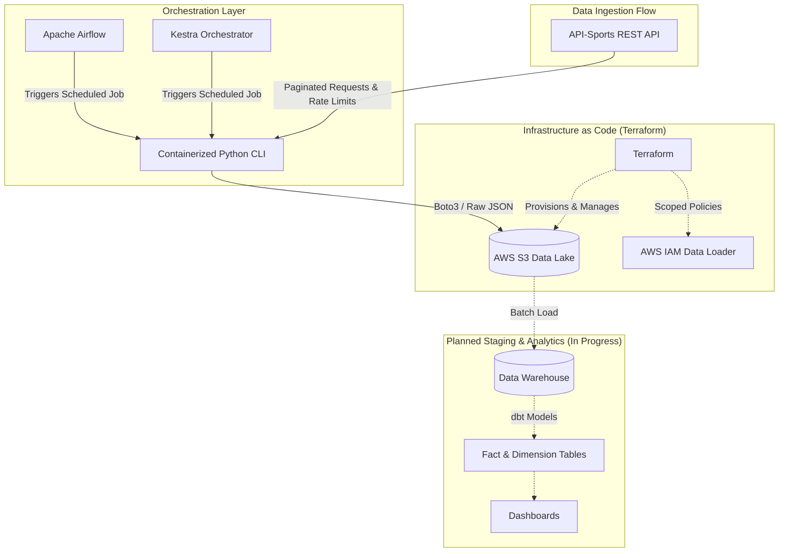

# ⚽ Football Data Pipeline (ELT)

[](https://www.python.org/)
[](https://docs.astral.sh/uv/)
[](https://www.terraform.io/)
[](https://aws.amazon.com/s3/)
[]()
[](#)

An end-to-end Data Engineering ELT pipeline designed to extract football sports statistics from API-Sports, store raw JSON payloads into an AWS S3 Data Lake, and automate batch execution workflows with Apache Airflow or Kestra.

>💡 Project Background:
>This project is inspired by the DataTalks.Club Data Engineering Zoomcamp, but completely re-engineered around a live external sports domain instead of the default NYC Taxi dataset.
>It features a custom CLI-based ingestion tool with pagination and API rate-limiting, optimized container packaging using Astral uv for fast dependency management executed under an unprivileged user, and fully automated cloud infrastructure provisioned via Terraform with remote S3 state storage and DynamoDB locking.

## 🏗 System Architecture



---

## ⚙️ Key Technical Features

* **Infrastructure as Code (IaC):** AWS S3 landing bucket and scoped IAM ingestion policies managed via **Terraform** (~> 6.0) with remote S3 backend state and DynamoDB state locking.
* **Resilient Ingestion Engine (`src/`):** Parameterized CLI built with `click` and `requests`. Features automated pagination, rate-limit sleep windows, dynamic S3 folder partitioning (`league_id / season / ingest_date`), and structured logging.
* **Orchestration Layer:** **Kestra 2.0** deployed as a standalone server backed by PostgreSQL 18 for pipeline scheduling and task execution.
* **Secure & Fast Containerization:** Multi-stage/lightweight Docker images leveraging Astral `uv` for sub-second dependency resolution, running under an unprivileged user (`ingest_user`) for container security.

---

## 📂 Repository Structure

```text
football-data-pipeline/
├── configs/                  # Pipeline configs and API endpoint definitions
├── orchestration/            
│   ├── airflow/              # Apache Airflow compose.yaml and DAGs
│   └── kestra/               # Kestra compose.yaml and Flows
├── src/                      # Clean Architecture source code
│   └── football_pipeline/
│       ├── cli.py            # CLI entrypoint
│       ├── core/             # Configuration and logging
│       ├── domain/           # Domain schemas and entities
│       ├── extractors/       # API-Sports extraction clients
│       ├── services/         # Ingestion orchestration services
│       └── storage/          # S3 storage clients and uploaders
├── terraform/                # IaC definitions (S3, IAM)
├── terraform-backend/        # IaC state bucket and lock table definitions
├── tests/                    # Unit and integration test suite
├── Dockerfile                # Hardened container build recipe (Python 3.13 + uv)
├── pyproject.toml            # Project packaging metadata and build definitions
└── uv.lock                   # Locked dependency tree
```

## 🛠 Tech Stack

| Domain | Tools / Technologies |
| :--- | :--- |
| **Language** | Python 3.13 |
| **Dependency Management** | Astral `uv`, `hatchling` |
| **CLI Framework** | `click` |
| **Cloud Storage** | AWS S3 |
| **Infrastructure as Code** | Terraform (AWS Provider ~> 6.0) |
| **Orchestration** | Apache Airflow 3.3.2, Kestra 2.0, PostgreSQL 18 |
| **Containerization** | Docker, Docker Compose |

---

## 🚀 Setup & Quickstart

### 1. Provision Infrastructure with Terraform
Navigate to the terraform directory to initialize and deploy the S3 Data Lake and IAM credentials:
```bash
# 1. Initialize remote state and lock table
cd terraform-backend
terraform init
terraform apply -auto-approve

# 2. Provision landing zone and IAM
cd ../terraform
terraform init
terraform plan -var="environment=dev"
terraform apply -var="environment=dev"
```

### 2. Configure Environment Variables
Create a .env file in the project root based on your credentials:

```.env
# Ingestion API Configuration
FLOW_API_FOOTBALL_KEY=your_football_api_key

# AWS Configuration & Credentials
FLOW_AWS_ACCESS_KEY_ID=your_aws_access_key_id
FLOW_AWS_SECRET_ACCESS_KEY=your_aws_secret_access_key
AWS_DEFAULT_REGION=eu-central-1
AWS_S3_LANDING_BUCKET_NAME=football-data-pipeline-landing-zone-dev

# Airflow Credentials & Security
AIRFLOW_POSTGRES_USER=airflow
AIRFLOW_POSTGRES_PASSWORD=airflow
AIRFLOW_POSTGRES_DB=airflow
_AIRFLOW_WWW_USER_USERNAME=admin
_AIRFLOW_WWW_USER_PASSWORD=admin
AIRFLOW_UID=50000
AIRFLOW_DOCKER_GID=999
FERNET_KEY=your_fernet_key_here

# Kestra Credentials
KESTRA_POSTGRES_USER=kestra
KESTRA_POSTGRES_PASSWORD=kestra_password
KESTRA_POSTGRES_DB=kestra
KESTRA_USER=admin@example.com
KESTRA_PASSWORD=admin_password
```

### 3. Launch Orchestrator
Lounch Airflow:
```bash
docker compose --env-file .env -f orchestration/airflow/compose.yaml up -d
```

Or Kestra:
```bash
docker compose --env-file .env -f orchestration/kestra/compose.yaml up -d
```

Access the Kestra Web UI at `http://localhost:8080`.

### 4. Run Manual Ingestion
You can test the ingestion engine directly using uv:
```bash
uv run football-pipeline --endpoint leagues --league-id 39
uv run football-pipeline --endpoint teams --league-id 39 --season 2024
```

Or run it inside the Docker container:
```bash
docker run --rm --env-file .env football-pipeline:latest football-pipeline --endpoint leagues --league-id 39
```

---

## 📌 Project Roadmap

- [x] Cloud infrastructure as code with Terraform (S3, IAM, S3 Remote State & DynamoDB Lock)
- [x] Ingestion CLI engine with rate-limiting, pagination, and S3 partitioning
- [x] Secure Docker container build with Astral uv and non-root user execution
- [x] Orchestration deployment via Docker Compose (Apache Airflow 3 & Kestra 2.0)
- [x] Bootstrap flows and DAGs for dimension tables extraction (Leagues, Teams)
- [ ] Scheduled daily batch ingestion flows for facts
- [ ] Data Warehouse integration (ClickHouse or BigQuery)
- [ ] Data modeling and staging layer with dbt
- [ ] Interactive analytical dashboard (Metabase or Superset)
